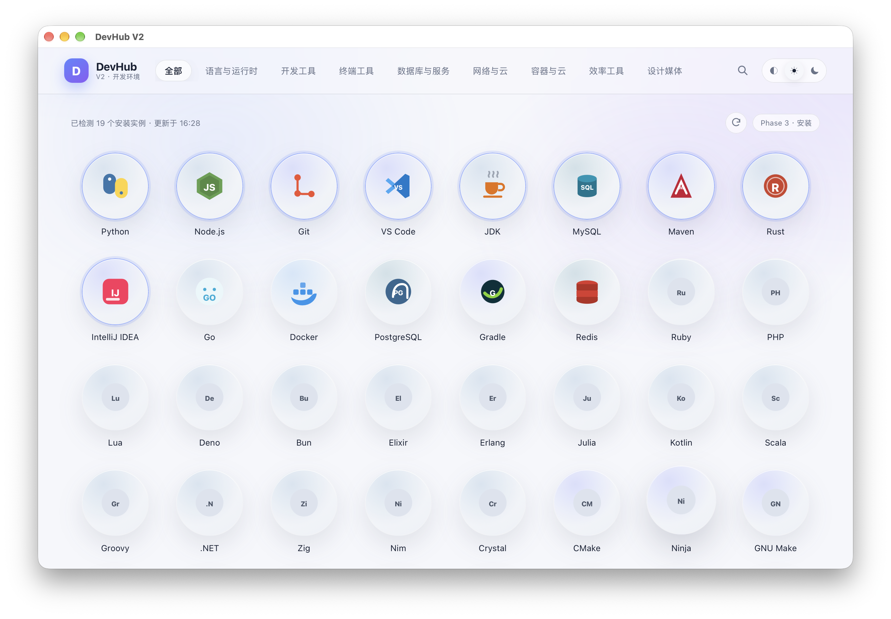
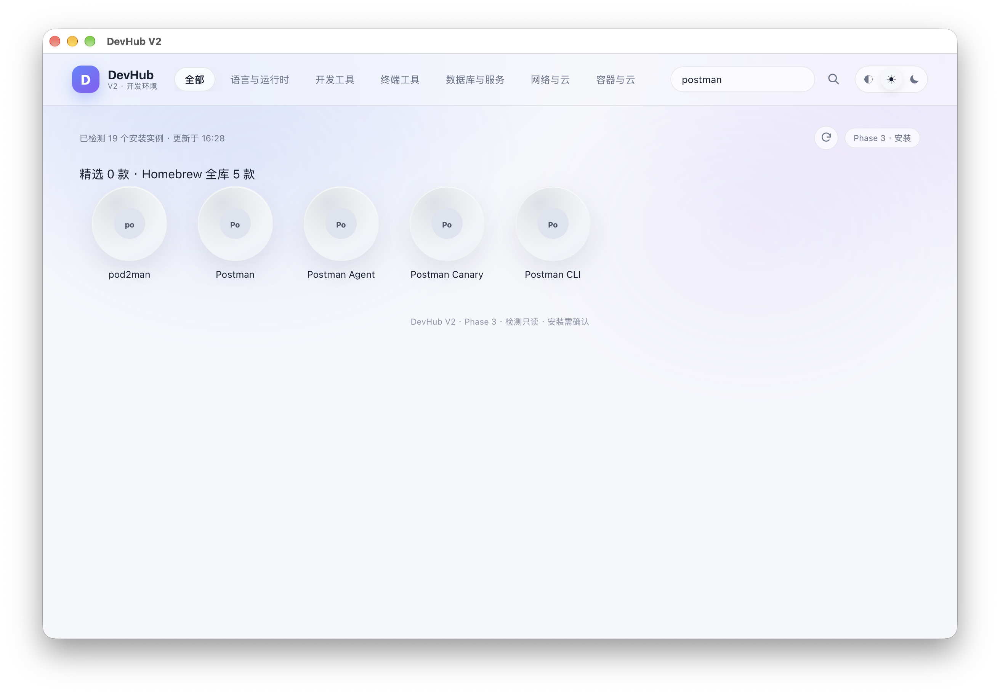
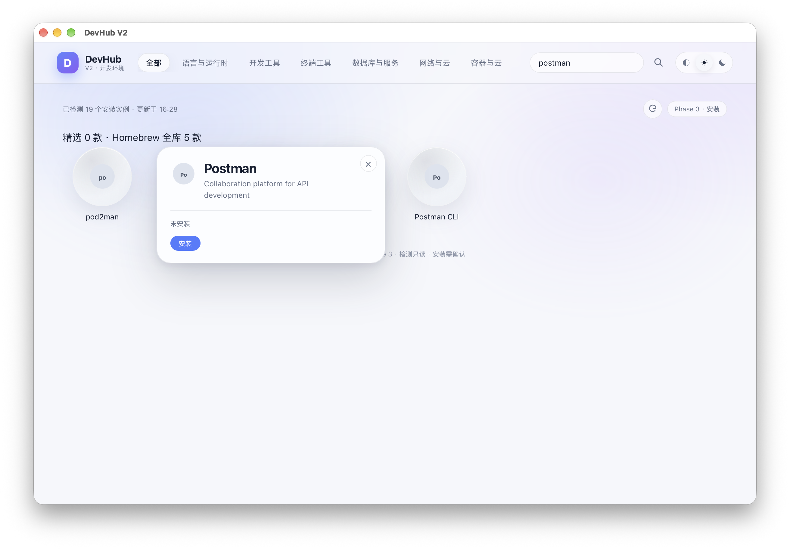
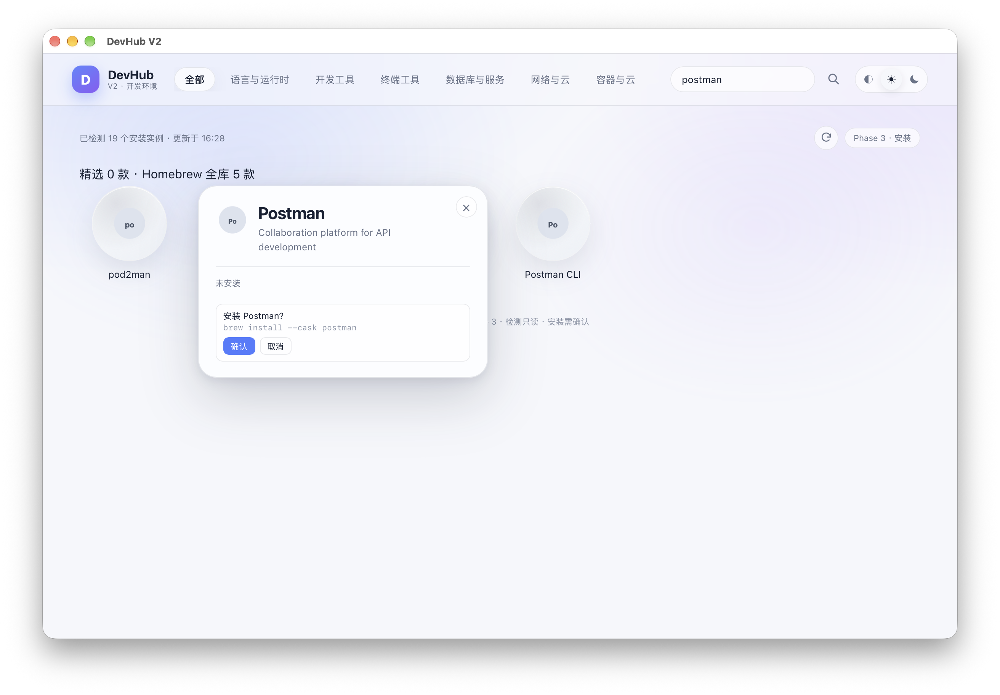

<p align="center">
  
</p>

<h1 align="center">DevHub V2</h1>

<p align="center">
  面向 macOS 的图形化开发环境管理器：安装、检测、卸载，都在一个极简圆形网格里完成。
</p>

<p align="center">
  <a href="https://github.com/cososo888/DevHub"></a>
  
  
  
  
  
  
</p>

---

## 简介

DevHub V2 是一个 **Tauri 2 + React + Rust** 的桌面应用，用来查看和管理本机开发环境。

它不维护自己的安装器，也不提供版本选择器。点击安装时，DevHub 只执行预先定义、经过审核的 **Homebrew** 命令；具体安装版本由 Homebrew 决定。

> **当前状态：macOS v0.1.0 可用。Windows 版尚未实现，只有交接文档和候选目录。**

核心原则：

- 不替代包管理器；
- 不伪造安装状态；
- 不静默获取管理员权限；
- 不删除用户数据或系统组件；
- 检测独立于 DevHub 的安装记录。

## 核心功能

### 精选软件库

- **100 款真实 Homebrew 软件**
- **84 个 formula + 16 个 cask**
- 8 个分类：
  - 语言与运行时
  - 开发工具
  - 终端工具
  - 数据库与服务
  - 网络与云
  - 容器与云
  - 效率工具
  - 设计媒体

所有包名均经过 Homebrew 验证；没有虚构包名。

### 搜索

- 精选库搜索；
- **Homebrew 全库搜索**：`brew search` + 批量 `brew info`；
- 查询 **大小写不敏感**；
- 输入查询时**忽略顶部分类**，真正全局搜索；清空后恢复分类；
- 320 ms 防抖、前端会话缓存、后端 5 分钟缓存；
- 每类最多 12 条，合并去重后最多 24 条；
- 加载、无结果、错误重试状态；
- 搜索结果使用同一个圆形详情卡片。

### 本机环境检测

- 原有 14 款软件使用深度检测：
  - 版本
  - 实际路径
  - 多实例
  - PATH / 安装来源
- 其他精选/搜索软件通过 Homebrew 包状态通用检测；
- 启动/刷新只读取一次 Homebrew 状态，不为 100 个软件逐个执行昂贵命令；
- 系统、官网、Homebrew、fnm、uv、rustup 等已有安装都会展示；
- **不是 DevHub 安装的软件不会显示为未安装**。

### 安装与卸载

- 不提供版本选择；
- 固定命令：
  ```text
  brew install <package>
  brew install --cask <package>
  brew uninstall <package>
  brew uninstall --cask <package>
  ```
- 安装前二次确认；
- 固定 argv 调用，不拼 Shell 字符串；
- 安装后通过 `brew list --versions` 和精确 formula JSON 二次验证；
- 查询失败不会伪装成“未安装”；
- 只允许卸载 Homebrew 当前管理的包；
- 系统/官网/手动安装不会被直接删除；
- 数据库/Redis 安装不会自动启动服务。

### 界面

- 圆形软件图标网格；
- 蓝色已安装、灰色未安装；
- 点击图标展开共享 morph 卡片；
- 安装圆环和单轨道不确定进度；
- 深色 / 浅色主题；
- 隐藏页面滚动条，保留滚轮/触控板/键盘滚动；
- 无官方图标时使用名称缩写默认图标。

## 界面展示

<p align="center">
  
</p>

<p align="center"><sub>100 款精选软件与 8 个分类</sub></p>

| Homebrew 全库搜索 | 搜索结果详情 |
| --- | --- |
|  |  |
| 搜索 `postman`，结果来自 Homebrew 全库 | 搜索结果进入统一详情卡片 |

<p align="center">
  
</p>

<p align="center"><sub>安装前显示固定 Homebrew 命令，确认前不会执行</sub></p>

## 技术栈

| 层 | 技术 |
| --- | --- |
| 桌面框架 | Tauri 2 |
| 后端 | Rust 2024 |
| 前端 | React 19 + TypeScript 6 |
| 构建 | Vite 8 |
| 数据 | SQLite（rusqlite） |
| 包管理 | Homebrew CLI |
| 测试 | Node test runner + Testing Library + Rust test |

## 安装

### 直接使用 macOS 安装包

当前提供 **Apple Silicon（arm64）** 的 DMG：

[**DevHub-V2-0.1.0-aarch64.dmg**](dist/DevHub-V2-0.1.0-aarch64.dmg)

SHA-256：

```text
888050f32880b04ecd2fd4026667948c0acdbb5dc594908c70606b62ec092347
```

安装：

1. 打开 DMG；
2. 将 `DevHub V2.app` 拖入 Applications；
3. 首次打开如果被 Gatekeeper 拦截，右键应用 → **打开**。

> **签名说明**：当前为本地 ad-hoc 签名，未使用 Apple Developer ID notarize。会触发 Gatekeeper/SmartScreen 提示，这是预期行为。
>
> 安装/卸载软件仍需本机有 Homebrew。仅查看本机环境不需要 Homebrew。

### 从源码运行

前置条件：

- macOS（Apple Silicon）
- Node.js 20+
- Rust stable
- Xcode Command Line Tools
- Homebrew（安装/卸载功能需要）

```bash
git clone https://github.com/cososo888/DevHub.git
cd DevHub
npm ci
npm run tauri -- dev
```

### 构建 macOS 安装包

```bash
npm run tauri -- build --bundles dmg
```

产物：

```text
src-tauri/target/release/bundle/dmg/DevHub V2_0.1.0_aarch64.dmg
```

## 开发

### 检查与测试

```bash
npm run check
npm run test:ui
cargo test --manifest-path src-tauri/Cargo.toml
```

当前基线：

- UI：**19 passed**
- Rust：**11 passed / 3 ignored**
- TypeScript：通过
- macOS release DMG：构建通过

### 常用命令

| 命令 | 作用 |
| --- | --- |
| `npm run dev` | 只启动 Vite 前端 |
| `npm run tauri -- dev` | 启动完整 Tauri 应用 |
| `npm run build` | 构建前端静态文件 |
| `npm run tauri -- build --bundles dmg` | 构建 DMG |
| `npm run test:ui` | UI/组件测试 |
| `npm run check` | TypeScript 类型检查 |
| `cargo test --manifest-path src-tauri/Cargo.toml` | Rust 测试 |

## 项目结构

```text
.
├── src/                          React 前端
│   ├── App.tsx                   首页、全局搜索、详情接线
│   ├── catalog.ts                100 款 macOS 精选目录
│   ├── components/               圆形网格、详情卡片、Logo、工具栏
│   ├── hooks/                    检测、安装任务、主题、减弱动画
│   └── lib/                      IPC 类型、搜索过滤
├── src-tauri/                    Rust/Tauri 后端
│   ├── src/lib.rs                Tauri 命令与任务
│   ├── src/homebrew.rs           Homebrew 适配、状态、搜索、安装/卸载
│   ├── src/detection.rs          本机环境检测
│   ├── src/process.rs            有界、固定参数的进程执行器
│   ├── src/storage.rs            SQLite 缓存与卸载历史
│   ├── tauri.conf.json           macOS 应用配置
│   └── tauri.windows.conf.json   Windows NSIS 规划配置
├── docs/                         报告、截图、Windows 交接资料
├── scripts/                      UI 与目录测试
├── dist/                         预构建 macOS DMG
└── package.json
```

## 开发进度

| 阶段 | 状态 | 内容 |
| --- | --- | --- |
| Phase 1 | 完成 | 圆形网格、详情卡片、主题、基础检测 |
| Phase 2 | 完成 | 真实本机检测、安装任务、进度与日志 |
| Phase 3 | 完成 | 100 款目录、全库搜索、通用安装、安全卸载 |
| macOS v0.1.0 | 可用 | Apple Silicon DMG |
| Windows 版 | **未实现** | winget provider、Windows 检测、NSIS 待开发 |

## Windows 支持计划

Windows 版只做：

- Windows 10/11 **x64**
- **winget**（不接 msstore / Chocolatey / Scoop）
- 不提供版本选择
- NSIS 安装包
- 未签名，接受 UAC 和 SmartScreen

当前已有：

- `docs/WINDOWS-PORT-REPORT.md`
- `docs/WINDOWS-TEAMMATE-GUIDE.md`
- `docs/windows/WINDOWS-HANDOFF.md`
- `docs/windows/winget-candidates.json`（**100 个候选，尚未在 Windows 验证**）
- `docs/windows/verify-winget.ps1`
- `src-tauri/tauri.windows.conf.json`

**Windows 代码尚未实现，当前不能构建 Windows 安装包。**  
100 个 winget ID 只是候选，必须由接手者在 Windows 上逐个验证后，才能作为最终目录。

## 已知限制

- 真实安装/卸载需要用户在图形界面确认；自动化测试不执行真实写操作。
- macOS DMG 未 notarize。
- 搜索最多展示 24 条结果，没有全库分页。
- 非 Homebrew 官网 app 不在 100 款通用检测范围内；原有 14 款保留深度检测。
- 数据库/Redis 安装不会自动启动服务。
- 首次缺少 Homebrew 时只提供安装引导，不静默提权。
- Windows 版尚未实现。

## 安全原则

- 固定命令和参数，不拼接用户输入；
- 包 ID 字符集校验；
- 安装/卸载前确认；
- 不静默获取管理员权限；
- 不删除用户数据、项目、数据库文件或系统组件；
- 只卸载明确由 Homebrew 管理的包；
- 查询失败与“未安装”严格区分。

## 贡献

欢迎提交 Issue 和 Pull Request。

- 功能/修复请从 `main` 创建分支；
- Windows 相关工作请基于 `windows-handoff`；
- 提交前运行 `npm run check`、`npm run test:ui` 和 Rust 测试；
- 不要提交真实安装/卸载后的本机状态数据；
- 不要修改旧版 DevHub 仓库；
- 未完成的 Windows 功能不要写成已完成。

## 文档

- [Phase 3 目录与搜索报告](docs/PHASE3-CATALOG-REPORT.md)
- [Go 安装验证误报修复](docs/GO-VERIFICATION-FIX.md)
- [Windows 版差异与底层问题](docs/WINDOWS-PORT-REPORT.md)
- [Windows 队友入门指南](docs/WINDOWS-TEAMMATE-GUIDE.md)
- [Windows 构建交接清单](docs/windows/WINDOWS-HANDOFF.md)

## 状态

- 版本：`0.1.0`
- 当前平台：macOS Apple Silicon
- Windows：规划中，未实现
- 许可证：暂未指定

---

<p align="center"><sub>DevHub V2 · 图形化终端操作与环境查看</sub></p>
