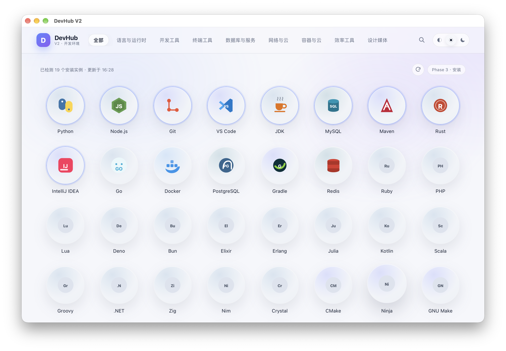
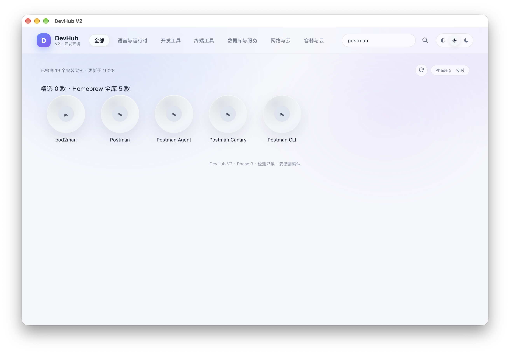
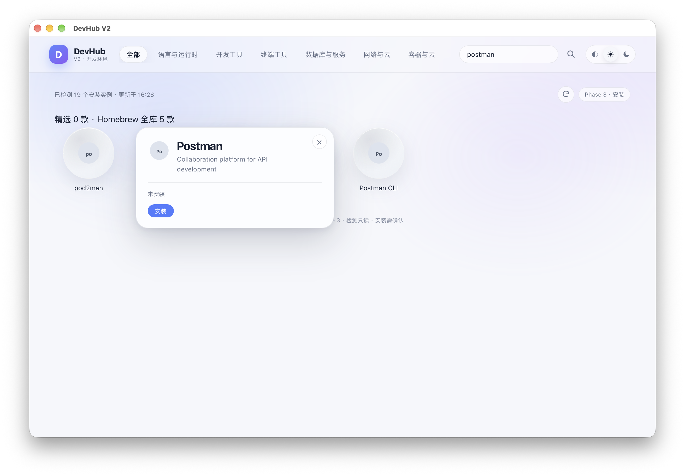
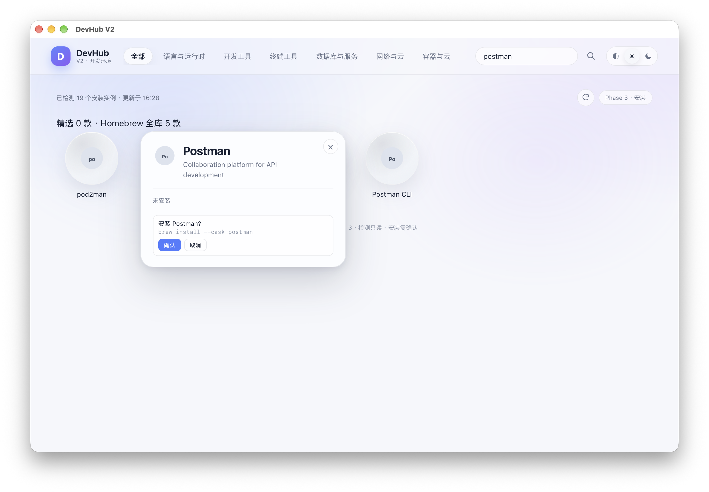

<p align="center">
  
</p>

<h1 align="center">DevHub V2</h1>

<p align="center">
  A minimal graphical development-environment manager for macOS.
</p>

<p align="center">
  <a href="https://github.com/cososo888/DevHub"></a>
  
  
  
  
  
  
</p>

---

[中文 README](README.md)

## Overview

DevHub V2 is a **Tauri 2 + React + Rust** desktop app for viewing and managing a local development environment.

It does not maintain its own installer and does not provide a version picker. When the user clicks Install, DevHub runs a reviewed **Homebrew** command. The installed version is whatever Homebrew selects.

> **Status:** macOS v0.1.0 is usable. Windows support is not implemented yet; the repository contains a handoff plan and candidate package list only.

Principles:

- Do not replace the package manager.
- Do not fabricate install state.
- Do not silently request administrator privileges.
- Do not delete user data or system components.
- Keep environment detection independent from DevHub's install history.

## Features

### Curated catalog

- **100 real Homebrew packages**
- **84 formulae + 16 casks**
- 8 categories:
  - Languages & runtimes
  - Developer tools
  - Terminal tools
  - Databases & services
  - Networking & cloud
  - Containers & cloud
  - Productivity
  - Design & media

Every package name is verified against Homebrew; no invented package names.

### Search

- Curated catalog search.
- **Homebrew full-library search** via `brew search` followed by a batched `brew info`.
- Case-insensitive.
- When a query is present, category filters are ignored; clearing the query restores the selected category.
- 320 ms debounce, session cache and a 5-minute backend cache.
- Up to 12 results per type, deduplicated and capped at 24 total.
- Loading, empty and retry states.
- Search results open the same circular detail card.

### Environment detection

- Deep detection for the original 14 tools: version, actual path, multiple instances and source.
- Generic Homebrew package state for the rest of the catalog.
- One Homebrew state query at startup/refresh, not one command per package.
- Existing system, official, Homebrew, fnm, uv and rustup installs remain visible.
- Software not installed by DevHub is not reported as uninstalled.

### Install and uninstall

- No version picker.
- Fixed commands:
  ```text
  brew install <package>
  brew install --cask <package>
  brew uninstall <package>
  brew uninstall --cask <package>
  ```
- Explicit confirmation before execution.
- Fixed argv; no shell string assembly.
- Post-install verification with exact version queries and exact formula JSON matching.
- Query failures are not reported as “not installed”.
- Only Homebrew-managed packages can be uninstalled.
- System, official and manual installs are displayed but not deleted.
- Database/Redis installation does not start services.

### Interface

- Circular software grid.
- Blue installed / gray not-installed state.
- Shared morph detail card.
- Installing ring and indeterminate progress animation.
- Light and dark themes.
- Hidden page scrollbar while preserving wheel, trackpad and keyboard scrolling.
- Default initial-based icon for packages without an official logo.

## Screenshots

<p align="center">
  
</p>

<p align="center"><sub>100 curated packages across 8 categories</sub></p>

| Homebrew search | Search result |
| --- | --- |
|  |  |
| Search `postman` in the Homebrew library | Results use the same detail card |

<p align="center">
  
</p>

<p align="center"><sub>Fixed Homebrew command shown before install</sub></p>

## Tech Stack

| Layer | Technology |
| --- | --- |
| Desktop shell | Tauri 2 |
| Backend | Rust 2024 |
| Frontend | React 19 + TypeScript 6 |
| Build | Vite 8 |
| Data | SQLite (rusqlite) |
| Packages | Homebrew CLI |
| Tests | Node test runner + Testing Library + Rust |

## Install

### Prebuilt macOS DMG

Apple Silicon (arm64):

[**DevHub-V2-0.1.0-aarch64.dmg**](dist/DevHub-V2-0.1.0-aarch64.dmg)

SHA-256:

```text
888050f32880b04ecd2fd4026667948c0acdbb5dc594908c70606b62ec092347
```

Steps:

1. Open the DMG.
2. Drag `DevHub V2.app` into Applications.
3. If Gatekeeper blocks the first launch, right-click the app and choose **Open**.

> The app is ad-hoc signed and not notarized. A Gatekeeper warning is expected.
>
> Homebrew is required for install/uninstall actions. View-only detection works without it.

### Run from source

Requirements:

- macOS Apple Silicon
- Node.js 20+
- Rust stable
- Xcode Command Line Tools
- Homebrew for install/uninstall actions

```bash
git clone https://github.com/cososo888/DevHub.git
cd DevHub
npm ci
npm run tauri -- dev
```

### Build the macOS DMG

```bash
npm run tauri -- build --bundles dmg
```

Output:

```text
src-tauri/target/release/bundle/dmg/DevHub V2_0.1.0_aarch64.dmg
```

## Development

```bash
npm run check
npm run test:ui
cargo test --manifest-path src-tauri/Cargo.toml
```

Baseline:

- UI: 19 passed
- Rust: 11 passed / 3 ignored
- TypeScript: passing
- macOS release DMG: builds

| Command | Purpose |
| --- | --- |
| `npm run dev` | Vite frontend only |
| `npm run tauri -- dev` | Full Tauri app |
| `npm run build` | Frontend production build |
| `npm run tauri -- build --bundles dmg` | Build DMG |
| `npm run test:ui` | UI/component tests |
| `npm run check` | TypeScript check |
| `cargo test --manifest-path src-tauri/Cargo.toml` | Rust tests |

## Project layout

```text
src/                         React frontend
src-tauri/                   Rust/Tauri backend
docs/                        Reports, screenshots and Windows handoff
scripts/                     UI/catalog tests
dist/                        Prebuilt macOS DMG
.github/                     CI, release workflow, issue/PR templates
```

## Status

| Phase | Status | Scope |
| --- | --- | --- |
| Phase 1 | Done | Grid, detail card, themes, initial detection |
| Phase 2 | Done | Real local detection, install task, progress/logs |
| Phase 3 | Done | 100 packages, full-library search, safe install/uninstall |
| macOS v0.1.0 | Available | Apple Silicon DMG |
| Windows | **Not implemented** | winget provider, Windows detection, NSIS |

## Windows plan

Windows support is planned as:

- Windows 10/11 **x64**
- **winget** only (no msstore, Chocolatey or Scoop)
- No version picker
- NSIS installer
- Unsigned, with UAC and SmartScreen warnings

Existing material:

- `docs/WINDOWS-PORT-REPORT.md`
- `docs/WINDOWS-TEAMMATE-GUIDE.md`
- `docs/windows/WINDOWS-HANDOFF.md`
- `docs/windows/winget-candidates.json` (**100 candidates, not verified**)
- `docs/windows/verify-winget.ps1`
- `src-tauri/tauri.windows.conf.json`

Windows code is not implemented. The current source cannot build a Windows installer, and the winget IDs must be verified on Windows before they become a final catalog.

## Known limitations

- Real installs/uninstalls require explicit user confirmation; automated tests do not perform writes.
- The macOS DMG is not notarized.
- Search is capped at 24 results; there is no full-library pagination.
- Non-Homebrew official apps are not in the 100-package generic detection scope.
- Database/Redis installation does not start services.
- Missing Homebrew is handled with guidance, not silent elevation.
- Windows support is not implemented.

## Security

- Fixed commands and arguments; no user input in shell strings.
- Package identifier validation.
- Confirmation before install/uninstall.
- No silent administrator elevation.
- No deletion of user data, projects, database files or system components.
- Only Homebrew-managed packages can be uninstalled.
- Query failure is distinct from “not installed”.

## Contributing

See [CONTRIBUTING.md](CONTRIBUTING.md), [CODE_OF_CONDUCT.md](CODE_OF_CONDUCT.md) and [SECURITY.md](SECURITY.md).

Before submitting:

```bash
npm run check
npm run test:ui
cargo test --manifest-path src-tauri/Cargo.toml
```

Windows work must use `windows-handoff` and must not claim completion until the NSIS build and manual checklist pass.

## Documentation

- [Chinese README](README.md)
- [Development guide](docs/development.md)
- [Phase 3 catalog/search report](docs/PHASE3-CATALOG-REPORT.md)
- [Go verification fix](docs/GO-VERIFICATION-FIX.md)
- [Windows report](docs/WINDOWS-PORT-REPORT.md)
- [Windows teammate guide](docs/WINDOWS-TEAMMATE-GUIDE.md)
- [Windows handoff](docs/windows/WINDOWS-HANDOFF.md)
- [Changelog](CHANGELOG.md)

## License

[MIT](LICENSE)
