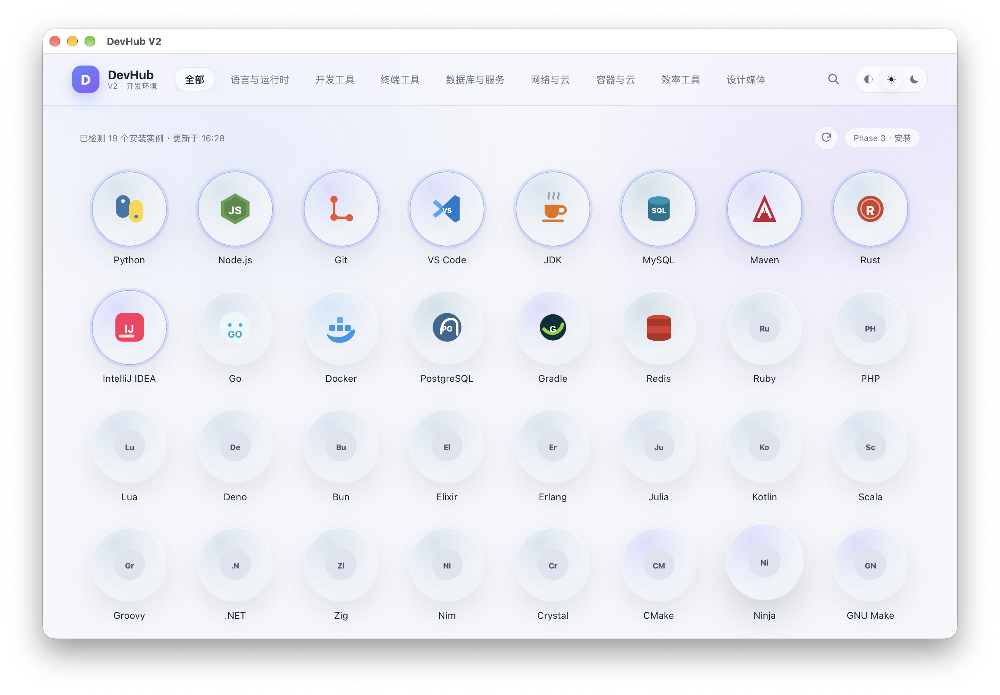
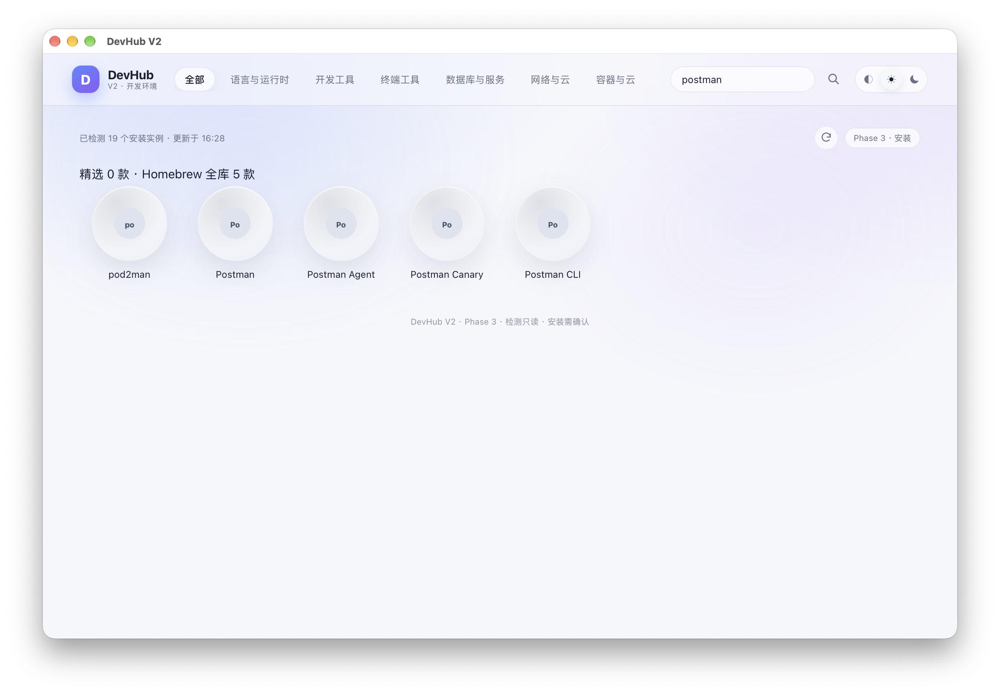
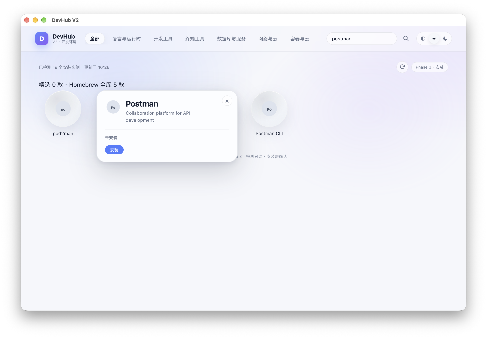
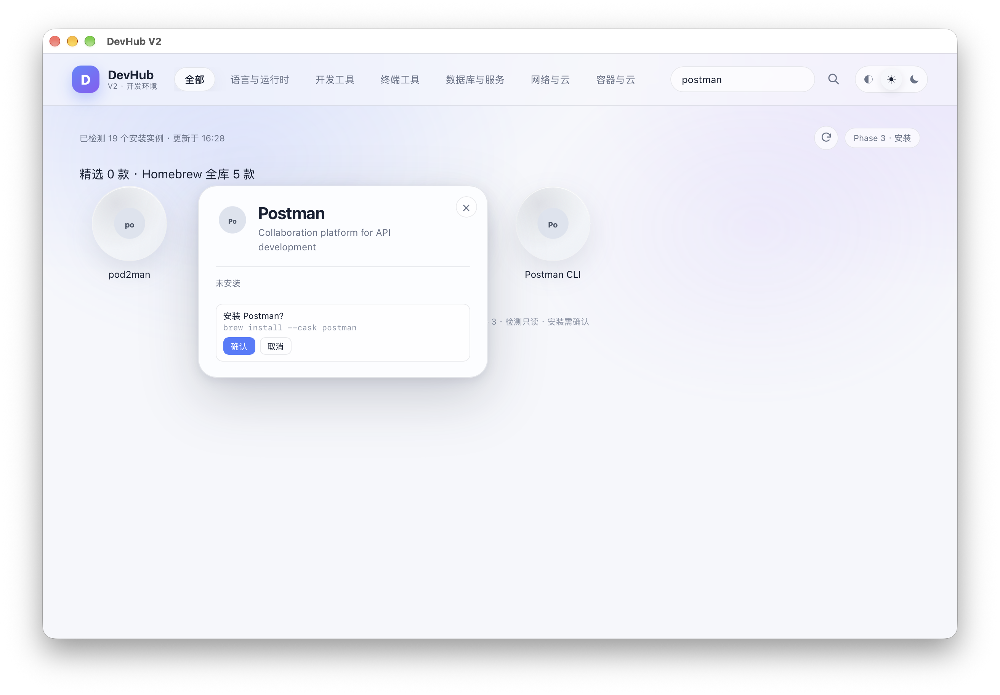

<p align="center">
  
</p>

<h1 align="center">DevHub V2</h1>

<p align="center">
  A minimal graphical development-environment manager for macOS.
</p>

<p align="center">
  <a href="https://github.com/cososo888/DevHub"></a>
  
  
  
  
  
</p>

---

[**Download for Mac · Apple Silicon**](https://github.com/cososo888/DevHub/releases/download/v0.2.0/DevHub-V2-0.2.0-macOS-arm64.dmg) · [Release notes and SHA-256](https://github.com/cososo888/DevHub/releases/tag/v0.2.0) · [中文 README](README.md)

## Overview

DevHub V2 is a **Tauri 2 + React + Rust** desktop app for viewing and managing a local development environment.

It does not maintain its own installer and does not provide a version picker. When the user clicks Install, DevHub runs a reviewed **Homebrew** command. The installed version is whatever Homebrew selects.

> The maintained release targets Apple Silicon Macs.

Principles:

- Do not replace the package manager.
- Do not fabricate install state.
- Do not silently request administrator privileges.
- Do not delete user data or system components.
- Keep environment detection independent from DevHub's install history.

## Features

### Curated catalog

- **100 real Homebrew packages**
- **84 formulae + 16 casks**
- 8 categories:
  - Languages & runtimes
  - Developer tools
  - Terminal tools
  - Databases & services
  - Networking & cloud
  - Containers & cloud
  - Productivity
  - Design & media

Every package name is verified against Homebrew; no invented package names.

### Search

- Curated catalog search.
- **Homebrew full-library search** via `brew search` followed by a batched `brew info`.
- Case-insensitive.
- When a query is present, category filters are ignored; clearing the query restores the selected category.
- 250 ms debounce, session cache and a 5-minute backend cache.
- Up to 12 results per type, deduplicated and capped at 24 total.
- Loading, empty and retry states.
- Search results open the same circular detail card.

### Environment detection

- Deep detection for the original 14 tools: version, actual path, multiple instances and source.
- Generic Homebrew package state for the rest of the catalog.
- Batch reads of Homebrew package state on startup and refresh.
- Existing system, official, Homebrew, fnm, uv and rustup installs remain visible.
- Unknown package state is reported separately.

### Install and uninstall

- No version picker.
- Fixed commands:
  ```text
  brew install --formula <package>
  brew install --cask <package>
  brew uninstall --formula <package>
  brew uninstall --cask <package>
  ```
- Explicit confirmation before execution.
- Fixed argv; no shell string assembly.
- Post-install verification with exact version queries and exact formula JSON matching.
- Query failures are not reported as “not installed”.
- Only Homebrew-managed packages can be uninstalled.
- System, official and manual installs are displayed but not deleted.
- Database/Redis installation does not start services.

### Interface

- Circular software grid.
- Verified installations have a blue halo.
- Shared morph detail card.
- Installing ring and indeterminate progress animation.
- Light, dark and automatic appearance. Close the window to keep the app in the Dock. Verified installs can send native notifications.
- Hidden page scrollbar while preserving wheel, trackpad and keyboard scrolling.
- Color brand icons with category artwork for additional tools.

## Screenshots

<p align="center">
  
</p>

<p align="center"><sub>100 curated packages across 8 categories</sub></p>

| Homebrew search | Search result |
| --- | --- |
|  |  |
| Search `postman` in the Homebrew library | Results use the same detail card |

<p align="center">
  
</p>

<p align="center"><sub>Fixed Homebrew command shown before install</sub></p>

## Tech Stack

| Layer | Technology |
| --- | --- |
| Desktop shell | Tauri 2 |
| Backend | Rust 2024 |
| Frontend | React 19 + TypeScript 6 |
| Build | Vite 8 |
| Data | SQLite (rusqlite) |
| Packages | Homebrew CLI |
| Tests | Node test runner + Testing Library + Rust |

## Install

### Prebuilt macOS DMG

The deployment target is macOS 11 or later on Apple Silicon. The release includes the DMG and a SHA-256 checksum. [Download v0.2.0](https://github.com/cososo888/DevHub/releases/download/v0.2.0/DevHub-V2-0.2.0-macOS-arm64.dmg)

1. Open the DMG, drag `DevHub V2.app` into Applications and launch it there. The current build is ad-hoc signed and has not been notarized. macOS may block the first launch. [Apple’s guide to opening downloaded apps](https://support.apple.com/en-us/102445)
2. Browse the catalog, search curated software and view detected tools immediately. The packaged app runs without Node.js or Rust.
3. Installing, uninstalling and searching the wider Homebrew catalog require Homebrew. When DevHub cannot find it in the usual locations, the in-app guide links to the official site. Check the requirements, run the official macOS `.pkg` installer, then return to DevHub and recheck. The sidebar guide also contains optional notification settings. [Homebrew](https://brew.sh/)

### Run from source

Requirements:

- macOS Apple Silicon
- Node.js 24.15+ (24.x) / 26+
- Rust stable
- Xcode Command Line Tools
- Homebrew for install/uninstall actions

```bash
git clone https://github.com/cososo888/DevHub.git
cd DevHub
npm ci
npm run tauri -- dev
```

### Build the macOS DMG

```bash
npm run package:macos
```

Output:

```text
src-tauri/target/release/distribution/0.2.0/
```

## Development

```bash
npm run check
npm run test:ui
cargo test --manifest-path src-tauri/Cargo.toml
```

| Command | Purpose |
| --- | --- |
| `npm run dev` | Vite frontend only |
| `npm run tauri -- dev` | Full Tauri app |
| `npm run build` | Frontend production build |
| `npm run package:macos` | Build DMG |
| `npm run test:ui` | UI/component tests |
| `npm run check` | TypeScript check |
| `cargo test --manifest-path src-tauri/Cargo.toml` | Rust tests |

## Project layout

```text
src/                         React frontend
src-tauri/                   Rust/Tauri backend
docs/                        Reports, screenshots and Windows handoff
scripts/                     UI/catalog tests
dist/                        Generated Vite frontend assets
.github/                     CI, release workflow, issue/PR templates
```

## Version history

See the [changelog](CHANGELOG.md) for macOS releases. The historical Windows handoff is archived in [docs/windows](docs/windows).

## Known limitations

- Real installs/uninstalls require explicit user confirmation; automated tests do not perform writes.
- The macOS DMG is not notarized.
- Search is capped at 24 results; there is no full-library pagination.
- Non-Homebrew official apps are not in the 100-package generic detection scope.
- Database/Redis installation does not start services.
- Missing Homebrew is handled with guidance, not silent elevation.
- Windows support is not implemented.

## Security

- Fixed commands and arguments; no user input in shell strings.
- Package identifier validation.
- Confirmation before install/uninstall.
- No silent administrator elevation.
- No deletion of user data, projects, database files or system components.
- Only Homebrew-managed packages can be uninstalled.
- Query failure is distinct from “not installed”.

## Contributing

See [CONTRIBUTING.md](CONTRIBUTING.md), [CODE_OF_CONDUCT.md](CODE_OF_CONDUCT.md) and [SECURITY.md](SECURITY.md).

Before submitting:

```bash
npm run check
npm run test:ui
cargo test --manifest-path src-tauri/Cargo.toml
```

Windows work must use `windows-handoff` and must not claim completion until the NSIS build and manual checklist pass.

## Documentation

- [Chinese README](README.md)
- [Development guide](docs/development.md)
- [Phase 3 catalog/search report](docs/PHASE3-CATALOG-REPORT.md)
- [Go verification fix](docs/GO-VERIFICATION-FIX.md)
- [Windows report](docs/WINDOWS-PORT-REPORT.md)
- [Windows teammate guide](docs/WINDOWS-TEAMMATE-GUIDE.md)
- [Windows handoff](docs/windows/WINDOWS-HANDOFF.md)
- [Changelog](CHANGELOG.md)

## License

[MIT](LICENSE)
